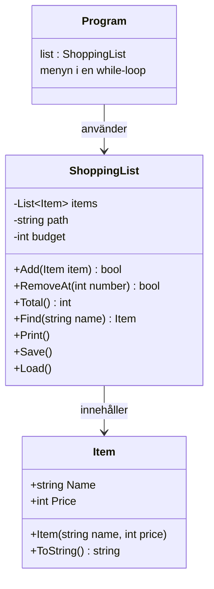

# Robust inköpslista

## Felrapport

### Fel 1: Totalsumma för låg
- Vad hände: totalsumman blev för låg. Tre varor exempelvis 10 + 10 + 50 blev 60kr istället för 70kr.

- Varför: Loopen i metoden total i shoppinglist.cs började med int i = 1. Då hoppar den över första varan. den börjar inte på index 0.

- Lösning: Jag ändrade int i = 1 till int i = 0. då hoppar den inte över första varan i listan.

### Fel 2: krasch vid felaktig inmatning

- Vad hände: Programmet kraschade med FormatException om man skrev något annat än ett tal i menyn, priset eller numret.

- Varför: Koden använde int.Parse för att göra inmatningen till ett tal. Om det inte går när man exempelvis skriver bokstäver blir det FormatException.

- Lösning: jag ändrade till int.TryParse, som returnerar false istället för att krascha, programmet skriver ett meddelande och går tillbaka till menyn. 

### Fel 3: Krasch vid ogiltigt nummer

- Vad hände: Om man valde "ta bort vara" och skrev ett nummer som inte fanns i listan, som exempelvis 0 -1 eller 999 kraschade programmet med ArgumentOutOfRangeException.

- Varför: Metoden RemoveAt i ShoppingList.cs anropade items.RemoveAt(number - 1 ) utan att kontrollera att numret fanns i listan. Därför blev det ArgumentOutOfRangeException.

- Lösning: RemoveAt kontrollerar nu att numret ligger mellan 1 och antalet varor. Annars returnerar den false istället för att ta bort något. Program.cs kollar det nu och matar ut "Det finns ingen vara med det numret".

### Fel 4: Save säger "sparad" även när det misslyckas

- Vad hände: När items.txt var skrivskyddad skrev programmet ändå "Listan är sparad." Ingenting sparades i filen.

- Varför: catch-blocket i Save var tomt och fångade alla fel utan att säga något. Meddelandet låg efter try/catch så det skrevs ut även när det blev fel.

- Lösning: Jag flyttade "Listan är sparad." in i try, efter File.WriteAllText, så det visas bara om det sparas. Den tomma catchen är utbytt mot IOException och UnauthorizedAccessException som skriver ut ett felmeddelande.

### Fel 5: Krasch när items.txt saknas 

- Vad hände: Om items.txt inte fanns kraschade programmet direkt vid start med FileNotFoundException.

- Varför: Load använde File.ReadAllText utan att först kolla om filen fanns.

- Lösning: Load kollar nu med File.Exists om filen finns. Om den inte gör det startar programmet med en tom lista.

### Fel 6: Krasch vid inläsning av filen

- Vad hände: Programmet kraschade vid start med IndexOutOfRangeException. Varor som syntes i listan hittades inte heller när man sökte på dem.

- Varför: Load delade filen på \n, men Save skriver \r\n. Det gjorde att ett \r hängde kvar i varje namn och att sista raden blev tom, vilket gav kraschen. Load använde dessutom int.Parse, som kraschar på trasiga rader.

- Lösning: Filen läses med File.ReadAllLines så att inga \r blir kvar. Tomma eller felaktiga rader hoppas över, och int.TryParse används i stället för int.Parse. 

Notering: I min första inlämning hade jag kommenterat bort list.Load() i Program.cs för att programmet inte skulle krascha. Nu är Load lagad och anropet är tillbaka.

## Designval

När en vara inte får plats i budgeten returnerar Add false. Den kastar alltså inget undantag. Jag valde false eftersom det inte är fel i programmet att budgeten tar slut. Det är ju något som kan hända i verkliga livet och något man måste förhålla sig till. Undantag använder jag i Item istället, för där handlar det om värden som aldrig får finnas, som ett tomt namn eller ett negativt pris. Det fungerar på samma sätt som RemoveAt som också returnerar false. 

I Program.cs kollar jag svaret med en if-sats och matar ut "Varan får inte plats i budgeten." om det blir false. 

När programmet startar läser varorna in från filen utan att budgeten kollas, annars skulle sparade varor kunna försvinna. 

## Klassdiagram

